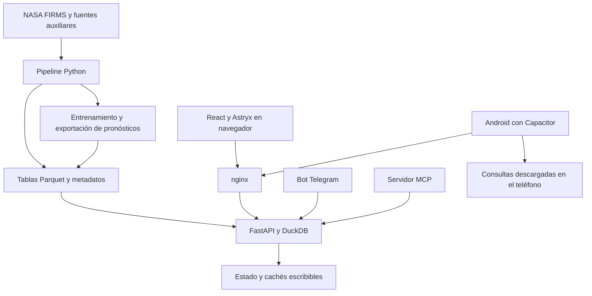
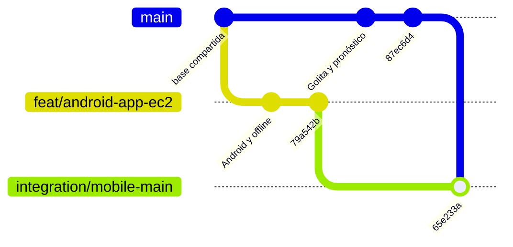

# Firely: contexto completo del proyecto

> Documento de entrega y continuidad técnica.
> Fecha de revisión: **15 de noviembre de 2026**.
> Base de esta revisión: rama **`integration/mobile-main`**, commit **`65e233a`**.
> Integra `main` en `87ec6d4` con la rama móvil `feat/android-app-ec2` en `79a542b`.
>
> Describe el código inspeccionado, los documentos del repositorio y el trabajo
> realizado durante esta sesión. Las direcciones locales, procesos activos y
> disponibilidades de servicios son una fotografía de la sesión, no garantías
> permanentes. No contiene llaves privadas, tokens ni contraseñas.

## Índice

1. [Resumen del proyecto](#1-resumen-del-proyecto)
2. [Problema que resuelve](#2-problema-que-resuelve)
3. [Usuarios y funciones](#3-usuarios-y-funciones)
4. [Arquitectura general](#4-arquitectura-general)
5. [Estructura del repositorio](#5-estructura-del-repositorio)
6. [Tecnologías](#6-tecnologías)
7. [Datos y metodología científica](#7-datos-y-metodología-científica)
8. [Modelo predictivo](#8-modelo-predictivo)
9. [Backend y API](#9-backend-y-api)
10. [IA y asistente Gotita](#10-ia-y-asistente-gotita)
11. [Frontend web](#11-frontend-web)
12. [App Android](#12-app-android)
13. [Modo sin conexión](#13-modo-sin-conexión)
14. [Alertas, bot, MCP y voz](#14-alertas-bot-mcp-y-voz)
15. [Docker, EC2 y conexiones locales](#15-docker-ec2-y-conexiones-locales)
16. [Configuración y secretos](#16-configuración-y-secretos)
17. [Cómo ejecutar y probar](#17-cómo-ejecutar-y-probar)
18. [Qué hicimos durante la sesión](#18-qué-hicimos-durante-la-sesión)
19. [Ramas y commits](#19-ramas-y-commits)
20. [Gitignore y archivos que se publican](#20-gitignore-y-archivos-que-se-publican)
21. [Validaciones realizadas](#21-validaciones-realizadas)
22. [Limitaciones y pendientes](#22-limitaciones-y-pendientes)
23. [Glosario técnico](#23-glosario-técnico)
24. [Archivos de referencia y continuidad](#24-archivos-de-referencia-y-continuidad)

## 1. Resumen del proyecto

**Firely es una plataforma para consultar y analizar la historia de actividad de
fuego observada por satélites**, con una interfaz web, una aplicación Android y
una API compartida.

El contexto original del repositorio es NASA Space Apps Challenge 2026, reto
«Harmonization of MODIS and VIIRS Hot Spots», con participación local en Saltillo,
Coahuila. Esta es la descripción del proyecto en el repositorio; este documento
no verifica registros, resultados ni reglas del evento.

La propuesta central consiste en hacer comparables observaciones de sensores
distintos y presentarlas como un calendario mensual de actividad de quemas.
Alrededor de ese núcleo existen mapas, análisis históricos, perspectivas futuras,
un asistente llamado **Gotita**, exportaciones, alertas e integraciones.

El trabajo de esta sesión se concentró en **llevar el frontend a Android,
conectarlo al backend de EC2 e integrar las novedades de `main` sin modificarla**.
El método científico y el modelo de pronóstico ya existían en el proyecto; no
los desarrollamos ni reentrenamos durante esta sesión.

## 2. Problema que resuelve

MODIS y VIIRS observan puntos de calor con distinta resolución y sensibilidad.
Por eso no basta con concatenar sus conteos.

- MODIS tiene detecciones con resolución aproximada de 1 km.
- VIIRS tiene detecciones de aproximadamente 375 m.
- VIIRS puede observar actividad pequeña que MODIS no detecta.
- También importan horarios de paso, cantidad de satélites y disponibilidad de
  cada serie.

Una unión ingenua puede mostrar un aumento artificial alrededor de la entrada
de VIIRS en 2012. Firely busca corregir esa diferencia instrumental para que la
comparación histórica tenga sentido.

**Un punto de calor no equivale automáticamente a un incendio confirmado.**
Tampoco equivale a una hectárea quemada ni al perímetro de un incendio.

## 3. Usuarios y funciones

| Usuario | Necesidad | Funciones relacionadas |
| --- | --- | --- |
| Brigadista | Consultar un área y reconocer su contexto, incluso con mala señal | Mapa, calendario, áreas guardadas, explicación resumida |
| Protección civil | Comparar situaciones y preparar información | Análisis, ficha, reportes, alertas de ejercicio |
| Investigador | Revisar series, incertidumbre y metodología | Datos descargables, método, API y consultas avanzadas |
| Gestor de territorio | Entender temporadas y recurrencia | Temporada, contexto, territorio y prioridad |
| Desarrollador | Integrar Firely en otros sistemas | API, widget, MCP, GeoJSON, OGC y KML |

### Recorrido principal

1. Seleccionar un lugar mediante búsqueda, coordenadas, límites o dibujo.
2. Elegir fechas, métrica y referencia estadística.
3. Consultar calendario y mapa.
4. Abrir un mes para revisar su detalle diario.
5. Consultar análisis y contexto.
6. Preguntar a Gotita, exportar resultados o guardar consultas para campo.

El área y las fechas se comparten entre vistas. La navegación se representa en
el fragmento de la URL, por ejemplo `#/asistente` o `#/explorar?...`.

## 4. Arquitectura general



Hay tres capas que conviene distinguir:

1. **Preparación científica:** ingesta, limpieza, armonización, análisis y
   entrenamiento. Se ejecuta en Python y produce archivos.
2. **Servicios:** la API consulta esos archivos y entrega respuestas estructuradas.
3. **Clientes:** web, Android, bot y MCP consumen la API.

La aplicación Android no ejecuta Docker ni entrena el modelo. Tampoco lleva
todo el histórico Parquet dentro del APK.

## 5. Estructura del repositorio

```text
Firely/
├── ai/                    Interpretación, búsqueda geográfica y redacción
├── api/
│   ├── app/               FastAPI, routers y acceso a datos
│   └── openapi.yaml       Contrato documentado
├── bot/                   Cliente y bot de Telegram
├── data/
│   ├── raw/               Datos originales; no modificar
│   ├── interim/           Resultados intermedios
│   ├── processed/         Tablas finales y modelos exportados
│   ├── external/          Datos auxiliares locales
│   └── schemas/           Contratos de tablas; sí se versionan
├── docs/                  Producto, metodología, planes y este contexto
├── infra/                 Dockerfiles, nginx y programador de tareas
├── mcp/                   Herramientas para asistentes externos
├── pipeline/              Procesamiento científico y pronóstico
├── tests/                 Pruebas Python
├── web/
│   ├── src/               Frontend compartido
│   ├── src/mobile/        Capacidades específicas de móvil y offline
│   ├── public/gotita/     Imágenes de los perfiles de Gotita
│   ├── android/           Proyecto nativo Android
│   ├── scripts/mobile.mjs Compilación, sincronización e instalación
│   ├── tests-mobile/      Pruebas de navegador móvil
│   ├── dist/              Build web generado; no versionar
│   └── mobile-dist/       Build para Android; no versionar
├── apps/                  Restos locales del prototipo móvil anterior
├── mobile-smoke/          Prueba local anterior de dispositivo
├── docker-compose.yml
├── requirements.txt
└── CLAUDE.md              Contexto y reglas históricas del proyecto
```

**La implementación Android activa de la integración está en `web/android/`.**
No debe confundirse con `apps/mobile/` de las ramas anteriores ni con
`mobile-smoke/`, que era una prueba mínima para verificar el teléfono.

## 6. Tecnologías

Las versiones siguientes proceden de los manifiestos inspeccionados. Algunas
dependencias tienen rangos, por lo que el lockfile determina la instalación exacta.

### Frontend y Android

| Tecnología | Versión declarada o familia | Uso |
| --- | --- | --- |
| React | 19.0.0 | Componentes, estado y renderizado |
| TypeScript | 5.7.3 | Tipos y comprobación estática |
| Vite | 8.x | Desarrollo y compilación del frontend |
| Astryx | 0.7.16 | Componentes, accesibilidad, layout y temas |
| StyleX | 0.19.x | Estilos compilados y reglas adaptativas |
| MapLibre GL | 6.x | Mapa interactivo |
| Terra Draw | 1.x | Dibujo de geometrías sobre el mapa |
| Recharts | 3.x | Gráficas |
| h3-js | 4.x | Operaciones H3 del cliente |
| Heroicons | 2.x | Iconos de interfaz |
| Capacitor | 8.x | Empaquetado y puente con Android |
| Capacitor App | 8.x | Ciclo de vida y botón Atrás |
| Capacitor Network | 8.x | Información de conectividad |
| Capacitor Filesystem | 8.x | Archivos persistentes y temporales |
| Capacitor Share | 8.x | Selector nativo para compartir exportaciones |
| Vitest | 5.x | Pruebas de lógica del frontend |
| Playwright | 1.x | Pruebas funcionales en navegador móvil |

### Backend y datos

| Tecnología | Uso |
| --- | --- |
| Python | Pipeline, API, bot e integraciones |
| FastAPI | Endpoints HTTP y documentación OpenAPI |
| Pydantic | Validación y esquemas de entrada/salida |
| Uvicorn | Servidor ASGI de la API |
| DuckDB | SQL sobre archivos Parquet |
| Parquet | Almacenamiento columnar de tablas científicas |
| NumPy, pandas y SciPy | Cálculo y tratamiento de datos |
| scikit-learn | Modelos auxiliares, agrupamiento y evaluación |
| LightGBM | Pronóstico de actividad de fuego |
| H3 | Índice geográfico jerárquico |
| Shapely, GeoPandas, PyProj y Rasterio | Procesamiento geoespacial del pipeline |
| xarray, netCDF4 y h5netcdf | Datos científicos y meteorológicos |
| Matplotlib | Figuras e imágenes del bot y del análisis |
| SDK de Anthropic | Extracción de intención y redacción opcionales |
| Piper y edge-tts | Síntesis de voz del servidor |
| HTTPX y Requests | Comunicación con APIs y fuentes externas |

### Infraestructura y herramientas

| Tecnología | Uso |
| --- | --- |
| AWS EC2 | Máquina donde se ejecuta el backend desplegado |
| Docker y Docker Compose | Imágenes y coordinación de servicios |
| nginx | Archivos estáticos, proxy inverso y límites de solicitudes |
| SSH | Administración y túneles de desarrollo |
| ADB | Instalación y comunicación con el Android por USB |
| Gradle | Compilación nativa Android |
| Java 21 y Android SDK 36 | Entorno de compilación Android utilizado |
| Git y GitHub | Versionado, ramas e integración |

La imagen de la API usa Python 3.11; la etapa de build web usa Node 22.
En la laptop también se utilizó Node 24. Para Python local se recomienda un
entorno virtual compatible con las dependencias; el contexto del proyecto
propone Python 3.12 cuando el Python del sistema da problemas con wheels.

## 7. Datos y metodología científica

### 7.1 Fuentes principales

- **NASA FIRMS:** detecciones MODIS y VIIRS, tanto archivo científico como NRT.
- **Cobertura del suelo:** biomas y clasificación auxiliar, por ejemplo MCD12Q1.
- **NASA POWER:** contexto climático y variables para el pronóstico.
- **GFWED / GEOS-5:** componentes de peligro meteorológico y pronóstico FWI.
- **ONI:** contexto de El Niño / La Niña.
- **INEGI y geoBoundaries:** geometrías y límites administrativos.
- **CONAFOR:** contraste con incendios reportados en México.
- Otras capas aportan población, localidades, áreas protegidas y relieve.

La existencia de una fuente en el código no implica cobertura completa de todos
los países, años y variables. La respuesta concreta y sus metadatos determinan
qué información está disponible.

### 7.2 Organización de los archivos

`raw` conserva los datos originales. `interim` contiene transformaciones de
trabajo. `processed` contiene las tablas que consulta la API.

Las tablas grandes pueden estar particionadas por país y año:

```text
data/processed/cell_month_harmonized/Mexico/year=2021/...
data/processed/cell_month_harmonized/Argentina/year=2021/...
```

Esta partición permite consultar subconjuntos y evita tratar todo el histórico
como un único archivo monolítico.

### 7.3 H3

H3 representa el territorio con una malla jerárquica, mayoritariamente hexagonal.
Firely utiliza resolución 6 para buena parte del procesamiento mensual:
aproximadamente 36 km² por celda, con variación geográfica.

La unidad científica principal es **celda × mes**. La API convierte un radio,
polígono o límite administrativo en un conjunto de celdas y agrega sus valores.

### 7.4 Armonización activa

La metodología revisada es **`1.2.0-hybrid-biome`**. Su explicación generada está
en [metodologia-armonizacion.md](metodologia-armonizacion.md).

El flujo general es:

1. Limpiar detecciones y homologar criterios de calidad.
2. Usar una referencia equivalente a un VIIRS Suomi-NPP.
3. Aprender la relación mensual entre MODIS y la referencia durante el solapamiento.
4. Probar agrupaciones por régimen de fuego, bioma o combinaciones.
5. Elegir configuraciones según validación, no por preferencia visual.
6. Estimar periodos sin la referencia y distribuir la actividad entre celdas,
   incluyendo información de vecindad.
7. Marcar estimaciones y producir bandas de incertidumbre.

Los documentos de planeación más antiguos mencionan quantile mapping y otras
alternativas. No deben confundirse con una descripción exacta de la versión
activa. Para el método realmente usado, consultar `pipeline/harmonize.py`, los
metadatos generados y el documento metodológico.

### 7.5 Variables importantes

| Campo | Significado |
| --- | --- |
| `count_harm` | Conteo armonizado; puede ser decimal porque es una estimación |
| `frp_harm` | Métrica armonizada de potencia radiativa del fuego |
| `count_harm_lo`, `count_harm_hi` | Banda de incertidumbre del conteo |
| `is_estimated` | Indica estimación; no debe deducirse solo por el año |
| `anomaly_ratio` | Relación con la referencia histórica del mes |
| `percentile` | Posición relativa frente a la distribución histórica |
| `return_period_years` | Periodo de retorno descriptivo estimado |
| `clear_frac` | Información de fracción despejada, donde existe |
| `methodology_version` | Versión del procedimiento científico |
| `data_cutoff` | Corte de datos declarado por esa salida |
| `attribution` | Fuente y atribución |

Un campo nulo significa que el dato no está disponible o no pudo estimarse;
no debe convertirse automáticamente en cero.

### 7.6 Validación

La armonización se compara con una corrección sencilla de factor fijo y utiliza
validación dejando años fuera. El documento metodológico contiene las métricas
generadas por país; no se recalcularon en esta sesión.

Los resultados agregados de un país no garantizan idéntico error en cualquier
celda pequeña. Tampoco eliminan la incertidumbre de los años estimados.

El calendario mensual armonizado, los puntos individuales del mapa, el detalle
diario observado y los eventos agrupados no son productos intercambiables.
El detalle diario y los agrupamientos tienen límites propios; no debe suponerse
que el número de puntos dibujados coincide con `count_harm`.

## 8. Modelo predictivo

### 8.1 Tres conceptos distintos

| Ruta | Qué entrega | Qué no significa |
| --- | --- | --- |
| `/risk` y `/priority/cells` | Índices de prioridad con componentes y pesos | No son probabilidades de ignición |
| `/risk/forecast` | Perspectiva de peligro meteorológico basada en FWI | No es la misma salida que el conteo mensual esperado |
| `/forecast` | Actividad de fuego esperada a 1–3 meses | No predice el lugar y momento exactos donde comenzará un incendio |

### 8.2 Pronóstico de actividad

La unidad del modelo es **celda H3 r6 × mes de emisión × horizonte**. Los
horizontes son 1, 2 y 3 meses.

La implementación contempla México, Argentina, Bolivia, Chile, Paraguay y
Uruguay. El objetivo de entrenamiento es `log1p(count_harm)` del mes futuro.
Los meses estimados desde MODIS no se usan como objetivos observados del modelo,
aunque pueden intervenir como antecedentes según el pipeline.

Las variables incluyen actividad reciente, actividad del mismo mes en otros
años, vecindad, clima, ONI, estacionalidad y contexto territorial.

El entrenamiento principal descrito en el código separa:

- Entrenamiento: 2012–2021.
- Validación: 2022.
- Prueba: 2023–2025.

Se comparan modelos con climatología, persistencia y el mismo mes del año previo.
Las climatologías que entran como variables deben usar información pasada para
evitar fuga de información del objetivo.

### 8.3 Salida y límites

El pronóstico puede incluir:

- Detecciones esperadas y actividad normal para ese mes.
- Intervalo 10–90 %.
- Probabilidades de quedar debajo, cerca o encima de lo normal.
- Métricas de desempeño frente a la climatología.
- Indicador `show`: `forecast` o `climatology`.

Si el modelo no supera la referencia para la escala evaluada, la API muestra la
climatología. Ganar por celda no implica ganar al agregar un país completo.

**La probabilidad de actividad por encima de lo normal no es la probabilidad de
que ocurra cualquier incendio.** Una frecuencia histórica de meses con detecciones
tampoco equivale a una predicción puntual de ignición.

La API lee `forecast_cell.parquet`, `forecast_area.parquet` y
`forecast_summary.json`. No entrena LightGBM en cada consulta ni en el celular.

Referencias: [plan del modelo](plan-modelo-predictivo.md),
[reporte generado](reporte-pronostico.md) y `pipeline/forecast_*.py`.

## 9. Backend y API

FastAPI valida solicitudes con Pydantic. La capa `api/app/db.py` abre conexiones
DuckDB en memoria para consultar los Parquet. En el código revisado se fija
un límite de memoria de 1 GB por conexión.

`FIRELY_API_MODE=real` selecciona el modo de datos reales. Sin esa configuración
hay rutas simuladas. Una respuesta de prueba no debe mostrarse como evidencia
científica real.

### Rutas principales

Las rutas de esta tabla son **internas a FastAPI**. Si se accede por nginx,
normalmente se antepone `/api`.

| Método y ruta | Función |
| --- | --- |
| `GET /openapi.json` | Contrato generado por la aplicación en ejecución |
| `GET /docs` | Interfaz de documentación, adaptada al proxy en main |
| `POST /resolve-area` | Interpretar lugar y fechas y devolver candidatos |
| `GET /calendar` | Serie mensual armonizada |
| `GET /calendar/daily` | Detalle diario del mes elegido |
| `GET /hotspots.geojson` | Detecciones geográficas |
| `GET /hotspots.csv` | Exportación de puntos |
| `GET /admin/search` | Búsqueda administrativa |
| `GET /events` | Eventos agrupados |
| `GET /season` | Temporada y desplazamiento temporal |
| `GET /analogs` | Años análogos |
| `GET /return-period` | Periodo de retorno |
| `GET /context` | Contexto climático mensual |
| `GET /weather` | Contexto meteorológico |
| `GET /weekday`, `GET /night` | Patrones semanales y nocturnos |
| `GET /territory`, `GET /reported` | Territorio y reportes disponibles |
| `GET /recent` | Detecciones NRT recientes |
| `GET /risk`, `GET /priority/cells` | Prioridad y sus componentes |
| `GET /risk/forecast` | Pronóstico meteorológico de peligro |
| `GET /forecast` | Actividad de fuego a 1–3 meses |
| `GET /animation/frames` | Cuadros mensuales de animación |
| `GET /tts` | Audio de narración |
| `POST /describe` | Explicación de resultados |
| `POST /reports/extract` | Extracción estructurada de reportes |
| `/subscriptions` | Gestión de suscripciones |
| `/alerts/cap` | Feed de alertas CAP de ejercicio aprobadas |
| `/ogc/...`, `/export.kml` | Integración geoespacial |

También existen herramientas como boletines, simulacros y consultas SQL de solo
lectura. La lista completa y vigente debe consultarse en `/openapi.json`; el YAML
documentado puede no reflejar inmediatamente cada cambio del código.

### Selectores de área

Las rutas admiten, según el endpoint, `bbox`, coordenadas con `radius_km`,
identificadores administrativos, celdas `h3` o una `geometry` serializada.

En `bbox` el orden es **oeste, sur, este, norte**, es decir, longitudes y latitudes
en ese orden. No confundirlo con `lat,lon`.

La geometría se obtiene de fuentes geográficas y validaciones del backend;
el modelo de lenguaje no inventa los límites.

## 10. IA y asistente Gotita

### 10.1 Función de la IA

La capa de IA interpreta texto, extrae intención y puede redactar explicaciones.
No es la fuente de las cifras científicas.

La implementación utiliza Anthropic opcionalmente. En el código revisado,
`FIRELY_LLM_MODEL` permite cambiar el modelo y el valor predeterminado es
`claude-haiku-5-5`. Esto describe la configuración del código, no garantiza
disponibilidad de ese modelo en todas las cuentas.

Sin clave, con una respuesta inválida o ante ciertos errores, existen reglas
locales y plantillas. Las reglas resuelven consultas útiles sin un servicio LLM.

### 10.2 Flujo de una pregunta histórica

```text
Pregunta
  -> POST /resolve-area
  -> intención: lugar y fechas
  -> candidatos del buscador geográfico
  -> selección automática o elección del usuario
  -> GET /calendar
  -> contexto y periodo de retorno, cuando están disponibles
  -> resumen, cifras, gráfica y enlaces de trazabilidad
```

Si el backend indica que una coincidencia no es ambigua, se puede elegir el
primer candidato válido. Si hay ambigüedad, se ofrecen opciones al usuario.

### 10.3 Preguntas futuras

Una pregunta sobre meses futuros no se envía como si hubiera observaciones
reales para esas fechas. El asistente consulta el pronóstico y el histórico.

Si la fecha está fuera del horizonte, explica la limitación y utiliza el
comportamiento histórico del mismo mes cuando existe. No rellena un calendario
futuro con detecciones observadas inexistentes.

### 10.4 Perfiles de Gotita

| Perfil | Explicación |
| --- | --- |
| Curioso | Lenguaje sencillo y menos terminología estadística |
| Brigadista | Resumen operativo sobre cuánto, cuándo y dónde |
| Científico | Más detalle de percentiles, intervalos, método y probabilidades |

Los perfiles cambian el personaje y la redacción, no las cifras de origen.
Las imágenes están empaquetadas en `web/public/gotita/`.

### 10.5 Interfaz móvil integrada

Conserva una conversación de una columna, entrada accesible dentro del viewport,
respuestas compactas y gráficos desplegables. Añade estado de conexión comprobado,
preguntas de ejemplo, cancelación, reintento, nueva conversación y preguntas de
seguimiento.

La animación respeta la preferencia de movimiento reducido. El panel de
pronóstico se adaptó para que sus barras no queden comprimidas en pantallas pequeñas.

## 11. Frontend web

El frontend activo está en `web/`. Usa React y Astryx, con estilos compilados
mediante StyleX y un tema Firely que extiende la base del sistema de diseño.

Las vistas principales son Explorar, Asistente, Método, Historia, Plataforma,
Ficha, Widget y Campo. La sección de identidad antigua se eliminó en main y
esa eliminación se respetó en la integración.

Piezas importantes:

- `state/AppState.tsx`: selección, fechas, idioma, tema, capas y navegación.
- `state/hash.ts`: serialización de estado en la URL.
- `api/client.ts`: contrato tipado y solicitudes al backend.
- `pages/Explorer.tsx`: mapa y panel de consulta.
- `pages/Assistant.tsx`: conversación y resultados de Gotita.
- `pages/Field.tsx`: descarga y administración de áreas guardadas.
- `lib/dataviz.ts`: colores y convenciones de visualización.
- `lib/narrate.ts`: reproducción de narración.

La identidad, las figuras, las métricas y la procedencia se reutilizan en Android.
La adaptación móvil no requiere una segunda implementación de la armonización.

## 12. App Android

### 12.1 Qué significa «nativa» en este proyecto

La app utiliza **Capacitor**, como la rama móvil anterior. Tiene un proyecto
Android real y se instala como APK, pero su interfaz React se ejecuta dentro de
un WebView local.

No es una reescritura de las pantallas en Kotlin o Jetpack Compose. Cambiar a
componentes Android completamente nativos sería otro alcance de trabajo.

### 12.2 Identidad y compilación

- Proyecto: `web/android/`.
- Identificador: **`org.firely.mobile.main`**.
- Nombre instalado: **Firely Main**.
- Configuración: `web/capacitor.config.ts`.
- Recursos web: `web/mobile-dist/`.
- APK debug: `web/android/app/build/outputs/apk/debug/app-debug.apk`.

Se eligió un identificador distinto al prototipo `org.firely.mobile` para poder
probar sin reemplazar esa instalación anterior.

El flujo es:

```text
TypeScript y React
  -> build de Vite en mobile-dist
  -> cap sync copia assets y registra plugins
  -> Gradle compila Android
  -> ADB instala y abre el APK
```

No se configura `server.url` para cargar toda la web desde EC2. La interfaz va
incluida en el APK; las solicitudes de datos van al backend.

### 12.3 Funciones específicas

- Navegación inferior y tratamiento de áreas seguras.
- Botón Atrás y ciclo de vida de la aplicación.
- Información de conectividad.
- Persistencia de consultas para campo.
- Compartir CSV e imágenes mediante el selector nativo de Android.
- Nuevo icono de Firely adaptado desde el SVG de main.

El PDF conserva el flujo web de impresión y necesita adaptación y validación
específica para Android. El funcionamiento de una descarga en navegador no debe
usarse como prueba automática de que funciona dentro del WebView.

### 12.4 Configuración del backend

La URL se configura internamente, principalmente mediante `VITE_API_URL` al
compilar. **Campo no muestra «Servidor Firely», la URL de la API ni botones de
configuración**, porque el usuario pidió retirarlos.

Instalaciones anteriores pueden conservar el valor de
`firely.mobile.backend.v1` en localStorage, con prioridad sobre el build.
Esto es un detalle de compatibilidad para desarrolladores, no una pantalla
que deba volver a mostrarse al usuario final.

La variante remota valida HTTPS. La variante de desarrollo USB permite HTTP de
loopback. Las claves de AWS, FIRMS, Anthropic o Telegram no se incorporan al APK.

## 13. Modo sin conexión

### 13.1 Estado real

**No existe una PWA implementada.** Se corrigieron documentos que la daban
erróneamente por existente. No hay que prometer un service worker ni un manifest
que este trabajo no implementó.

El modo de campo consiste en **guardar respuestas de la API**, no en descargar
todo el dataset y ejecutar DuckDB-WASM en el teléfono.

### 13.2 Qué se guarda

La descarga considera área, fechas, métrica, referencia, filtro y mes seleccionado.
Puede incluir:

- Calendario mensual en las variantes que usa el frontend.
- Temporada, análogos y eventos disponibles.
- Patrones semanales, nocturnos y territorio.
- Contexto, si el periodo cumple el límite de hasta cinco años.
- Detalle diario y retorno del mes seleccionado.

Los calendarios requeridos deben descargarse correctamente. Si falla una
consulta opcional, se registra como no incluida y se informa en la descarga.
Las respuestas simuladas no se guardan como paquetes de datos reales.

### 13.3 Dónde se guarda

Filesystem utiliza `Directory.Data` en Android, en la carpeta `firely-field-v1`.
La implementación web del plugin utiliza IndexedDB.

Cada paquete tiene identificador, backend, fecha, selección, recursos, consultas
no disponibles, tamaño, versión metodológica, corte y atribución. El límite de
almacenamiento por paquete es 20 MiB de JSON serializado.

Cada descarga escribe un archivo nuevo. No se sobrescribe la descarga anterior
durante una actualización, y los archivos JSON incompletos se omiten al listar.

La persistencia del navegador no convierte al sitio en una PWA: sin servidor
que entregue sus assets, el sitio no adquiere por eso un arranque offline.

### 13.4 Cuándo se recupera una respuesta guardada

Solo ante un fallo de red y para rutas históricas admitidas. Se exige coincidencia
del backend y de la consulta completa, incluidos los filtros.

- Un HTTP 500 o 503 no se oculta automáticamente con datos viejos.
- Una consulta cancelada no debe recuperar una respuesta antigua.
- Cambiar fechas o métrica puede requerir otra descarga.
- La interfaz indica que se consultaron datos guardados y su fecha.

### 13.5 Qué no está cubierto

No se guardan pronósticos, detecciones recientes, viento, propagación, prioridad
en vivo ni respuestas remotas del asistente. No hay descarga offline de teselas
ni garantía de un mapa base sin señal.

Los archivos para compartir se escriben en `Directory.Cache`; los paquetes de
campo se escriben en `Directory.Data`. Son finalidades y duraciones distintas.

## 14. Alertas, bot, MCP y voz

### Alertas y Telegram

El proyecto tiene suscripciones por área, evaluación, previsualización y pruebas
de envío. El bot también admite consultas y distintas funciones de la API.

Un cambio importante del main integrado es el autoservicio de suscripciones:
el código actual crea suscripciones aprobadas automáticamente para el chat del
suscriptor, con mensajes de ejercicio/prueba y baja desde Telegram.

Eso no equivale a publicar alertas CAP hacia la población. La publicación CAP
es una función separada que conserva revisión humana y estados de ejercicio.
Los documentos más antiguos que exigen aprobar manualmente toda suscripción
deben leerse considerando esta evolución.

Sin `TELEGRAM_BOT_TOKEN` no se debe afirmar que el envío real quedó validado.
Esta sesión no envió mensajes de Telegram para probar la integración.

### Programador de tareas

`infra/scheduler.py` utiliza UTC y un registro persistente de ejecuciones:

| Tarea | Programación del código |
| --- | --- |
| `pipeline.daily_update` | Diaria, desde las 06:10 UTC |
| `pipeline.alerts_job` | Diaria, desde las 06:30 UTC |
| `pipeline.bulletin_job` | Semanal, lunes desde las 07:00 UTC |

Los fallos se reintentan con una separación de una hora. No basta con que el
contenedor exista: hay que revisar estado, registro y resultados de cada tarea.

### MCP y otros formatos

El servidor MCP expone herramientas sobre la API para clientes compatibles.
Admite ejecución local por stdio y transporte HTTP streamable mediante nginx.
No duplica el cálculo científico en el modelo de lenguaje.

También existen widget, GeoJSON, KML y rutas OGC para integración con sitios y
herramientas SIG.

### Voz

La narración utiliza `GET /tts`. En el código, el orden predeterminado de motores
es `edge,piper`, configurable con `FIRELY_TTS_ENGINE`.

- edge-tts obtiene voz neuronal de un servicio externo.
- Piper permite síntesis local en el servidor y descarga archivos de voz cuando
  hacen falta.
- El frontend conserva una alternativa mediante voces del navegador.

Los modelos de voz y el audio se almacenan en el estado/caché del servidor, no en
el repositorio ni dentro del APK. La primera solicitud puede requerir red y
descarga de un modelo. La presencia de `/tts` no demuestra por sí sola que todos
los motores e idiomas ya se probaron en el teléfono.

## 15. Docker, EC2 y conexiones locales

### 15.1 Servicios de Compose

| Servicio | Responsabilidad |
| --- | --- |
| `api` | FastAPI y consulta de datos |
| `web` | Compilación del frontend y nginx |
| `mcp` | Herramientas MCP por HTTP |
| `bot` | Bot Telegram, opcional según configuración |
| `scheduler` | Actualizaciones y evaluaciones periódicas |

El diseño separa los Parquet de lectura del estado escribible. La API monta los
datos procesados en solo lectura; el scheduler tiene el montaje de escritura
necesario para actualizar tablas.

nginx publica la web y reenvía `/api/` hacia `api:8000` en la red Docker. Aplica
un límite de 10 solicitudes por segundo por IP, con ráfagas configuradas.

`api` es un nombre de servicio interno de Docker. No es una dirección que el
teléfono pueda resolver desde internet.

### 15.2 EC2

El backend del equipo se encontró en una instancia EC2 administrada por SSH
con usuario `ubuntu`. Se verificaron contenedores de API, web, MCP y scheduler.

La última comprobación mostró una API real disponible por HTTP. HTTPS no estaba
disponible en el puerto 443 durante esa revisión. No se configuraron dominio,
certificado ni terminación TLS en esta sesión.

La IP pública y las rutas de llaves deben obtenerse de la configuración local o
del responsable de AWS; no se deben asumir permanentes.

### 15.3 Vistas utilizadas en la laptop

| Dirección de la sesión | Uso |
| --- | --- |
| `http://localhost:8081` | Frontend limpio de main, servido con Docker |
| `http://localhost:5175/#/asistente` | Vista previa de la rama móvil integrada |
| `http://localhost:5173` | Vista local anterior de desarrollo |
| `http://localhost:8080` | Otra versión local existente; no asumir que es la más reciente |

Para la vista de main se creó una copia temporal en
`/tmp/firely-main-87ec6d4`. Sus overrides y su configuración local no forman parte
del main versionado ni representan un despliegue permanente.

El backend local de esa prueba encontró errores de permisos al leer archivos
montados. Cambiar el usuario del contenedor no resolvió la restricción. Para
entregar una vista funcional se conectó el nginx de esa copia al backend de EC2.
No se cambiaron los permisos de los datasets como solución ni se corrigió la
causa general del problema de montajes.

### 15.4 Ruta utilizada al final para el teléfono

```text
Firely Main en Android
  -> http://localhost:8081/api visto desde el teléfono
  -> adb reverse por USB
  -> puerto 8081 de la laptop
  -> nginx local
  -> API real de EC2
```

En el teléfono, `localhost` significa el propio teléfono. La redirección ADB es
lo que permite llegar a la laptop.

También se mantuvo una redirección de compatibilidad del puerto 18080 del
teléfono al 8081 de la laptop, por las compilaciones anteriores.

Esta ruta depende del cable y de los servicios locales. No es todavía la
conexión independiente de una app de producción por datos móviles.

### 15.5 Alternativa SSH probada anteriormente

```text
Android -> USB -> localhost:18080 en laptop
                    -> túnel SSH -> nginx de EC2 -> API
```

El túnel SSH y el proxy HTTP local son dos configuraciones distintas. La ruta
final de esta integración utiliza el proxy local del puerto 8081; no debe
afirmarse que toda conexión actual pasa necesariamente por el túnel SSH.

## 16. Configuración y secretos

| Variable | Propósito |
| --- | --- |
| `FIRELY_API_MODE` | Datos reales o modo simulado |
| `FIRELY_DATA_PROCESSED` | Directorio de tablas procesadas |
| `FIRELY_DATA_RAW`, `FIRELY_DATA_INTERIM` | Rutas del pipeline |
| `FIRELY_STATE_DIR` | Estado, suscripciones y cachés escribibles |
| `FIRELY_PORT` | Puerto publicado por Compose |
| `FIRELY_DATA_GID` | Grupo para permisos del directorio de datos |
| `FIRMS_MAP_KEY` | Acceso a datos recientes de FIRMS |
| `ANTHROPIC_API_KEY` | Servicio LLM opcional |
| `FIRELY_LLM_MODEL` | Modelo configurado para la capa de IA |
| `TELEGRAM_BOT_TOKEN` | Credencial del bot |
| `FIRELY_PUBLIC_URL`, `FIRELY_PUBLIC_API_URL` | Enlaces públicos generados |
| `FIRELY_MCP_ALLOWED_HOSTS`, `FIRELY_MCP_ALLOWED_ORIGINS` | Configuración del MCP HTTP |
| `FIRELY_TTS_ENGINE` | Orden de motores de voz |
| `VITE_API_URL` | URL del cliente, incorporada durante el build |
| `FIRELY_API_PROXY_TARGET` | Destino del proxy local de Vite |
| `FIRELY_API_PROXY_PATH` | Conservar o quitar `/api` en el proxy de desarrollo |
| `FIRELY_USB_API_URL` | URL para compilar la variante USB |
| `ANDROID_HOME`, `ANDROID_SDK_ROOT` | Ubicación del SDK |
| `ANDROID_SERIAL` | Dispositivo ADB elegido, cuando hay varios |

Los secretos van en configuración del servidor o archivos locales ignorados.
Un archivo `.pem` es una llave privada para SSH: no se importa en React ni se
incluye en Android. Se utilizó un archivo local llamado `firely.pem`, al que se
ajustaron permisos a `600`.

La URL pública de una API no es una contraseña. Se retiró de Campo por diseño
de producto, no porque ocultarla sustituya la seguridad del backend.

El código de la API permite CORS abierto. CORS no sustituye autenticación ni
autorización; el endurecimiento de los endpoints con efectos de escritura debe
revisarse antes de considerar un despliegue de producción.

## 17. Cómo ejecutar y probar

Los comandos siguientes usan ejemplos sin credenciales. Las variantes `env ...`
son utilizables tanto en fish como en shells habituales.

### Revisar el estado de Git

```sh
git status --short --branch
git log -5 --oneline
```

Antes de cambiar de rama, revisar cambios locales. No usar limpieza o restauración
forzada para resolver archivos desconocidos. Durante la sesión se conservó un
cambio local de permisos en `data/schemas/tables.json`, fuera de los commits.

### Frontend de desarrollo

Desde `web/`:

```sh
npm ci
npm run dev
```

Para usar el proxy local, copiar `web/.env.example` a `web/.env.local` y ajustar
su destino. Si se apunta al nginx remoto a través de SSH, conservar `/api`;
si se apunta a FastAPI directamente, quitar ese prefijo.

```sh
npm run build
npm run preview
```

### Despliegue estándar del repositorio

Desde la raíz, con datos y configuración preparados:

```sh
docker compose up -d --build api web
docker compose ps
```

El puerto estándar es 8080, salvo `FIRELY_PORT`. En la laptop de esta sesión ese
puerto ya correspondía a otra versión; se usó 8081 para main.

### APK Android

Desde `web/`:

```sh
npm ci
npm run apk
```

Para fijar un backend HTTPS:

```sh
env VITE_API_URL=https://TU_HOST/api npm run apk
```

`npm run mobile:build` genera `mobile-dist`. `npm run android:sync` también
sincroniza el proyecto Android. `npm run apk` genera el APK debug.

### Instalar por USB usando el proxy local

Con depuración USB autorizada y el backend accesible por el puerto 8081:

```sh
adb devices -l
cd web
npm run android:usb
```

El script compila, sincroniza, genera el APK, configura la redirección, instala
con `-r` y abre Firely Main. Un dispositivo `unauthorized` requiere aceptar el
aviso de depuración en la pantalla del teléfono.

Para otro destino local:

```sh
env FIRELY_USB_API_URL=http://localhost:18080/api npm run android:usb
```

### Túnel SSH de desarrollo

```sh
chmod 600 /ruta/firely.pem
ssh -i /ruta/firely.pem -N -L 127.0.0.1:18080:127.0.0.1:80 ubuntu@IP_PUBLICA
```

Ese proceso debe permanecer activo mientras se use el túnel. El puerto local
18080 reenvía al nginx del servidor; no expone un puerto nuevo en EC2.

### Pruebas del frontend

Desde `web/`:

```sh
npm test
npm run mobile:build
npm run test:mobile
npx astryx doctor --built mobile-dist
```

Las pruebas de interfaz usan por defecto Brave en `/usr/bin/brave-browser`.
`FIRELY_BROWSER` permite elegir otro ejecutable Chromium. Las pruebas E2E deben
usar el build móvil apropiado: ejecutar contra un bundle viejo puede producir
fallos que no correspondan al código recién editado.

### Backend y pipeline locales

Usar un entorno virtual; no instalar las dependencias científicas globalmente.
Consultar `requirements.txt`, `api/requirements.txt` y las listas de `infra/`,
porque desarrollo, procesamiento y runtime no requieren exactamente lo mismo.

La secuencia científica general comienza con ingesta y limpieza, sigue con H3,
cobertura y armonización, y produce derivados, eventos, validación y metadatos.
Para pronóstico: clima y panel de variables, entrenamiento, evaluación y exportación.
Los comandos y requisitos de cada etapa están en `pipeline/README.md`.

No ejecutar una reconstrucción completa de años de datos solo para abrir la UI.

## 18. Qué hicimos durante la sesión

### 18.1 Revisión inicial y ejecución

- Revisamos rama, commits y remoto para identificar qué versión estaba activa.
- Detectamos varios despliegues Docker y distinguimos sus puertos.
- Levantamos una copia de main y verificamos respuestas HTTP.

### 18.2 Definición de la app móvil

- Revisamos descripción, plan y ramas móviles anteriores.
- Confirmamos que la app previa utilizaba React, Astryx y Capacitor.
- Corregimos las afirmaciones de PWA existente.
- Documentamos la diferencia entre una app con Capacitor y una UI Android
  completamente reescrita con componentes nativos.

### 18.3 Android basado en el frontend compartido

- Se creó el proyecto nativo `web/android/`.
- Se añadieron plugins App, Filesystem, Network y Share.
- Se añadieron scripts de build, sincronización e instalación.
- Se separó `dist/` de `mobile-dist/`.
- Se añadieron navegación inferior, soporte de Atrás, áreas seguras y exportaciones.
- Se conservó el prototipo anterior en sus ramas y archivos locales.

### 18.4 Áreas de campo

- Implementamos paquetes persistentes por consulta y backend.
- Añadimos descarga, cancelación, listado, reapertura y borrado.
- Conservamos versiones previas si una actualización falla.
- Añadimos avisos de procedencia y límites de uso offline.
- Retiramos la sección del servidor, la URL y sus controles de Campo por petición
  del usuario.

### 18.5 Conexión con EC2 y teléfono

- Ajustamos permisos de la llave SSH y verificamos acceso a la instancia.
- Comprobamos que la API era real y que el calendario respondía.
- Probamos túnel SSH, redirecciones ADB e instalación en un Android físico.
- El teléfono utilizado fue un Samsung SM-S928B; pasó inicialmente por el estado
  `unauthorized` hasta que el usuario aceptó la depuración.
- Se instalaron y abrieron APK debug sin publicar una app en una tienda.

### 18.6 Mejora del asistente móvil

- Se eliminó la dependencia de un layout estrecho pensado para dos columnas.
- Se mantuvo el campo de escritura accesible dentro de la pantalla.
- Se compactaron las respuestas y se hicieron desplegables las gráficas.
- Se añadieron estado de conexión, ejemplos, detener, reintentar y reiniciar.
- Se verificaron anchos pequeños, incluyendo 320 píxeles.

### 18.7 Publicación y protección de archivos locales

- Se revisaron archivos salientes y patrones de secretos.
- Se amplió `.gitignore` para datasets, llaves, binarios, cachés y prototipos locales.
- Se publicó `feat/android-app-ec2` en GitHub.
- No se subieron los datasets locales ni la llave SSH.

### 18.8 Actualización de main e integración

- Se actualizó main por fast-forward hasta `87ec6d4`.
- Se revisaron siete commits nuevos del compañero.
- Se levantó su frontend limpio para compararlo.
- Se creó `integration/mobile-main` desde la rama móvil.
- Se hizo un merge real y se resolvieron conflictos de App, Assistant y rutas.
- Se integraron Gotita, tres perfiles, consultas futuras, logo y novedades de main.
- Se conservaron las funciones Android y Campo sin ajustes técnicos.
- Se adaptaron las barras del pronóstico a pantallas pequeñas.
- Se compiló e instaló el APK integrado y se verificó una consulta real a EC2.

## 19. Ramas y commits

### Ramas relevantes en esta revisión

| Rama | Estado y propósito |
| --- | --- |
| `main` | Código del compañero, revisado en `87ec6d4` |
| `feat/mobile-ui` | Trabajo móvil anterior de Firely Glass |
| `test` | Otra etapa anterior del móvil y su conexión por USB |
| `feat/mobile-main-ec2` | Primera implementación Android de esta sesión |
| `feat/android-app-ec2` | Versión móvil publicada, con exclusiones de Git revisadas |
| `integration/mobile-main` | Merge de main sobre la versión móvil; rama de trabajo actual |

### Hitos de la sesión

| Commit | Cambio |
| --- | --- |
| `a578815` | Android desde main, paquetes de campo y configuración inicial del backend |
| `b33faa6` | Asistente móvil mejorado y proxy local hacia EC2 |
| `8a8e763` | Eliminación de la sección de servidor de Campo |
| `79a542b` | Exclusión de datasets, secretos y artefactos generados |
| `65e233a` | Merge de main con Gotita y pronóstico en la integración móvil |

El commit de integración tiene como padres `79a542b` y `87ec6d4`. Es decir,
no se copió solo una pantalla: el historial contiene ambas líneas de trabajo.



En el momento de esta revisión, `feat/android-app-ec2` sí estaba publicada y
tenía upstream. `integration/mobile-main` estaba guardada localmente, sin upstream
remoto configurado. Verificar ese estado antes de asumir que otra persona ya
puede descargar la integración.

**No se hizo merge de la app móvil hacia main.** La instrucción explícita del
usuario fue mantener ese trabajo en una rama aparte.

## 20. Gitignore y archivos que se publican

### Se excluyen

- Datasets de `data/raw`, `interim`, `processed` y `external`.
- `.env` y variantes locales, excepto ejemplos.
- Llaves y almacenes de certificados: `.pem`, `.key`, `.p12`, `.pfx`, `.jks` y similares.
- Configuración local de AWS y de la herramienta de desarrollo.
- `node_modules`, builds web y cachés.
- APK, AAB, AAR, Gradle, `local.properties` y assets copiados por Capacitor.
- Resultados de pruebas, reportes y previews generados.
- `mobile-smoke/`, como prototipo local anterior.

### Se conservan

- Código Python, React, TypeScript y Android.
- `data/schemas/`, porque contiene contratos de tablas, no los datasets pesados.
- Lockfiles de dependencias.
- Gradle Wrapper y configuración necesaria para reconstruir Android.
- Imágenes de producto, Gotita, metodología y otros assets utilizados por la app.
- Ejemplos de configuración sin secretos.

`.gitignore` no elimina archivos del disco y no retira automáticamente archivos
que ya estaban versionados. Antes de publicar, revisar el índice de Git y el
historial saliente, no únicamente la lista de archivos ignorados.

## 21. Validaciones realizadas

En la integración se ejecutaron:

| Validación | Resultado registrado |
| --- | --- |
| Build TypeScript y Vite | Correcto |
| Pruebas de frontend | 66 pruebas, 17 archivos, correctas |
| Pruebas móviles Playwright | 4 pruebas correctas |
| Astryx doctor | 0 fallos; 2 advertencias relacionadas con fuentes externas |
| Gradle debug | APK generado correctamente |
| Instalación ADB | Correcta en el teléfono conectado |
| Consulta real a EC2 | Gotita resolvió Arteaga y mostró datos históricos |
| Navegador de prueba | Sin errores JavaScript ni desbordamiento horizontal en la consulta revisada |

Las pruebas móviles cubren selección de lugar, perfiles, preguntas futuras,
cancelación, reintento y áreas guardadas. Utilizan fixtures controlados; esos
datos no forman parte de la aplicación publicada.

También se hizo una prueba con datos reales, independiente de esos fixtures.
La última respuesta revisada declaró `1.2.0-hybrid-biome`, NASA FIRMS y corte
`2026-08-31`. No debe asumirse que todas las tablas o servicios comparten ese corte.

No se reentrenó el modelo ni se repitió toda la suite Python durante el merge.
Tampoco se verificaron exhaustivamente voz, notificaciones reales, publicación
CAP o todos los países en un teléfono físico.

## 22. Limitaciones y pendientes

### Para una app independiente de la laptop

1. Disponer de un endpoint público HTTPS estable.
2. Compilar la variante remota con esa dirección.
3. Probarla por datos móviles sin ADB, túnel ni proxy de la computadora.
4. Preparar firma, distribución y versiones de publicación si se quiere una tienda.

### Para campo

- Verificar cierre y reapertura del APK real en modo avión con varios paquetes.
- Medir almacenamiento y comportamiento ante falta de espacio.
- Decidir e implementar una estrategia específica de mapa base offline.
- Mantener visibles fechas, procedencia y consultas no incluidas.

### Para robustez de servicios

- Resolver la restricción de montajes locales si se necesita un backend
  completamente local en este entorno.
- Revisar estado real del scheduler y sus credenciales; un proceso que reinicia
  no equivale a una actualización diaria exitosa.
- Verificar motores de voz y descarga/caché de modelos en el despliegue real.
- Revisar autenticación, autorización y límites de endpoints de escritura.

### Para continuidad del equipo

- Revisar y, cuando corresponda, publicar `integration/mobile-main`.
- No mezclarla con main sin una decisión del equipo.
- Seguir reconciliando documentos viejos con el estado del código.
- Mantener separado «existe en código», «pasó con fixtures» y «se probó con
  servicios/datos reales».

## 23. Glosario técnico

| Término | Explicación dentro de Firely |
| --- | --- |
| Hotspot / punto de calor | Anomalía térmica observada por un satélite |
| MODIS | Sensor utilizado para una parte importante de la historia anterior |
| VIIRS | Sensor de mayor resolución espacial utilizado como referencia |
| FIRMS | Servicio de NASA del que se obtienen detecciones de fuego |
| SP | Archivo de procesamiento científico estándar |
| NRT | Datos casi en tiempo real, provisionales respecto al archivo científico |
| Armonización | Corrección de diferencias instrumentales para comparar series |
| FRP | Potencia radiativa del fuego, una medida energética |
| Bioma | Categoría ecológica o de cobertura usada para contextualizar el fuego |
| Régimen de fuego | Patrón de comportamiento usado para agrupar celdas |
| H3 | Índice geográfico jerárquico de celdas |
| Resolución H3 | Nivel de detalle de la malla; no es la resolución del sensor |
| Bbox | Rectángulo oeste-sur-este-norte |
| Geometría | Forma espacial, como un polígono |
| GeoJSON | Formato JSON para geometrías y sus atributos |
| Parquet | Archivo de tablas columnar, comprimido y apto para análisis |
| Particionado | Separación de datos en directorios como país y año |
| DuckDB | Motor SQL embebido que consulta archivos analíticos |
| Climatología | Comportamiento de referencia de un lugar y mes en su historia |
| Anomalía | Desviación o relación respecto a una referencia |
| Percentil | Posición dentro de una distribución de valores |
| Periodo de retorno | Frecuencia histórica estimada de una magnitud; no es una cita de cuándo ocurrirá |
| ONI / ENSO | Indicadores relacionados con El Niño y La Niña |
| FWI | Índice de condiciones meteorológicas favorables al fuego |
| LightGBM | Biblioteca de modelos de árboles con boosting |
| Horizonte | Cuántos meses hacia adelante se estima |
| log1p | Transformación `log(1+x)`, útil para valores no negativos y ceros |
| Terciles | Tres categorías de una distribución: inferior, central y superior |
| Skill | Desempeño relativo frente a una referencia, no una garantía individual |
| Backtest | Evaluación simulando predicciones sobre periodos históricos reservados |
| Fuga de información | Uso accidental de datos futuros o del objetivo al entrenar |
| API REST | Interfaz HTTP para consultar y modificar recursos |
| Endpoint | Ruta específica de la API |
| OpenAPI | Descripción estructurada de rutas, parámetros y respuestas |
| Pydantic | Validación de estructuras y tipos de datos |
| ASGI | Interfaz de aplicaciones Python atendida por Uvicorn |
| CORS | Reglas del navegador para solicitudes entre orígenes |
| Proxy inverso | Servidor que recibe una solicitud y la reenvía al backend |
| Imagen Docker | Paquete reproducible de un servicio |
| Contenedor | Ejecución de una imagen Docker |
| Volumen / bind mount | Mecanismo para aportar o conservar archivos fuera del contenedor |
| EC2 | Servicio de máquinas virtuales de AWS |
| SSH | Protocolo para administración y túneles autenticados |
| PEM | Formato que puede contener la llave privada usada para SSH |
| TLS / HTTPS | Capa de transporte cifrado para HTTP |
| Capacitor | Runtime que integra el frontend web con una app nativa |
| WebView | Componente Android que renderiza la interfaz web local |
| Plugin nativo | Puente para acceder a capacidades del teléfono desde JavaScript |
| APK | Paquete instalable de Android |
| AAB | Formato de publicación Android usado para distribución mediante tiendas |
| Gradle | Sistema de compilación del proyecto Android |
| ADB | Herramienta para depuración y comunicación con dispositivos Android |
| adb reverse | Redirección desde un puerto del teléfono a un puerto de la computadora |
| Loopback / localhost | Dirección del propio dispositivo, no de otra máquina |
| Build | Resultado compilado a partir del código fuente |
| Asset | Imagen, fuente u otro recurso que utiliza la interfaz |
| Token de diseño | Variable compartida de color, espaciado o tipografía |
| Viewport | Área visible disponible para la interfaz |
| IndexedDB | Persistencia estructurada disponible en el navegador |
| PWA | Web instalable con capacidades específicas; no es la implementación de esta sesión |
| Service worker | Proceso del navegador que puede gestionar caché y solicitudes |
| Fixture | Respuesta o dato controlado utilizado solo en pruebas |
| E2E | Prueba funcional de un recorrido completo de usuario |
| Rama | Línea de trabajo independiente en Git |
| Commit | Registro de un conjunto de cambios |
| Merge | Integración de historiales de dos ramas |
| Conflicto | Cambios que Git no puede combinar automáticamente |
| Upstream | Rama remota asociada para seguimiento y sincronización |
| MCP | Protocolo para exponer herramientas a asistentes compatibles |
| CAP | Formato estandarizado de mensajes de alerta |
| TTS | Síntesis de voz a partir de texto |

## 24. Archivos de referencia y continuidad

| Si necesitas entender… | Empieza por… |
| --- | --- |
| Qué busca el producto | [firely-descripcion.md](firely-descripcion.md) |
| Prioridades y criterios de terminado | [firely-plan.md](firely-plan.md) |
| Armonización realmente documentada | [metodologia-armonizacion.md](metodologia-armonizacion.md) |
| Diseño del pronóstico | [plan-modelo-predictivo.md](plan-modelo-predictivo.md) |
| Métricas generadas del pronóstico | [reporte-pronostico.md](reporte-pronostico.md) |
| Compilación y uso Android | [web/ANDROID.md](../web/ANDROID.md) |
| Integración móvil inicial | [mobile-main-ec2.md](mobile-main-ec2.md) |
| Despliegue | [infra/README.md](../infra/README.md) |
| Comandos científicos | [pipeline/README.md](../pipeline/README.md) |
| Herramientas MCP | [mcp/README.md](../mcp/README.md) |
| Rutas reales de la API | `api/app/main.py` y routers montados |
| Acceso a datos | `api/app/db.py` y `api/app/real.py` |
| Intención y geocodificación | `ai/intent.py` y `ai/gazetteer.py` |
| Asistente móvil | `web/src/pages/Assistant.tsx` |
| Offline | `web/src/mobile/fieldStore.ts` y `fieldDownload.ts` |
| Conexión y compatibilidad | `web/src/mobile/backend.ts` |
| Reglas visuales | `web/AGENTS.md` |

### Instrucciones para retomar el trabajo

1. Revisar rama, HEAD y cambios locales; no asumir que se está en main.
2. Leer este documento junto con las instrucciones del directorio que se editará.
3. Confirmar qué backend y qué puerto se están usando; no confundir web, API y MCP.
4. Conservar Campo sin URL ni ajustes del servidor.
5. Mantener las cifras y geometrías vinculadas a respuestas reales de la API.
6. No volver a describir como existente una PWA o un mapa offline no implementados.
7. Trabajar en la rama de integración o en otra rama del móvil, según el alcance;
   no integrar hacia main por iniciativa propia.
8. Compilar, ejecutar las pruebas relevantes y comprobar el recorrido afectado.
9. Mantener datasets, llaves y artefactos generados fuera de Git.
10. Actualizar este contexto cuando cambien arquitectura, conexión o estado de entrega.
