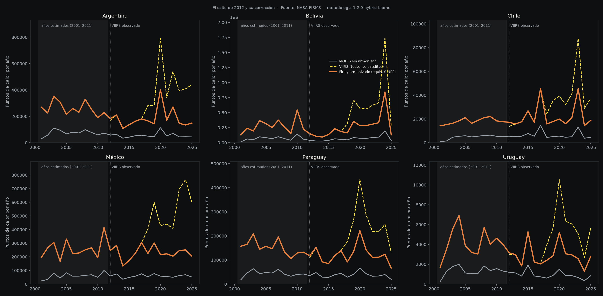

# Cómo armonizamos MODIS y VIIRS

*Versión de la metodología: `1.2.0-hybrid-biome` · Datos MODIS hasta 2026-08-31, VIIRS hasta 2026-07-31 · Fuente: NASA FIRMS*

> Generado por `pipeline/methodology_doc.py` a partir de `data/processed/metadata/harmonization_summary.json`.
> No editar a mano: se regenera con cada corrida de `pipeline.harmonize`.

## 1. El problema en una frase

MODIS (2000 en adelante) y VIIRS (2012 en adelante) detectan incendios con ojos distintos. VIIRS ve
pixeles de 375 m y MODIS de 1 km, así que VIIRS descubre muchos fuegos pequeños que MODIS no ve.
Si se pegan las dos series sin corregir, aparece un **salto falso en 2012**: parece que hay entre 3 y 4 veces más
fuego (en 2013, VIIRS cuenta 2.6–3.8 veces los puntos de MODIS), pero lo único que cambió fue el sensor. Es como comparar fotos de una cámara de 1 megapíxel con
las de un celular nuevo.



*Gris: MODIS sin corregir. Amarillo discontinuo: VIIRS (todos los satélites, sube además en 2018 y 2023
porque entran NOAA-20 y NOAA-21). Naranja: la serie armonizada de Firely, continua en todo el periodo.*

## 2. Qué producimos

Una sola serie, **en unidades de "un VIIRS Suomi-NPP"**, para cada celda de ~36 km² (malla H3 resolución 6)
y cada mes desde 2001. Así, un marzo de 2005 y un marzo de 2021 son comparables. Dos medidas:
el **conteo de puntos de calor** y la **potencia radiativa del fuego (FRP, en MW)**.

## 3. Los pasos, en orden

**Paso 1: limpiar.** Se descartan volcanes y fuentes fijas (`type ≠ 0`), las detecciones de confianza baja
de VIIRS (MODIS: confianza menor a 30) y los duplicados exactos, incluidos los que aparecen a la vez en el
resumen anual y en las solicitudes personalizadas.

**Paso 2: elegir quién es la referencia en cada época.**

| Periodo | Qué hay en la serie armonizada |
|---|---|
| 2012-02 a 2026-10 | **VIIRS S-NPP observado.** Es la referencia: no se corrige, se usa tal cual. |
| 2001-01 a 2012-01 | **Estimado desde MODIS** (esto es lo que se armoniza). Marcado `is_estimated = true`. |
| 2001-01 a 2002-07 | Solo hay Terra (Aqua empezó en julio de 2002): se usa un modelo propio solo con Terra. |
| Meses finales sin VIIRS (hasta 2026-08-31) | El procesamiento estándar de FIRMS llega a MODIS (2026-08-31) antes que a VIIRS (2026-07-31): esos meses se **estiman desde MODIS** con el mismo modelo y se marcan como estimados. |
| Tras el apagado de S-NPP (2 de noviembre de 2026) | Si NOAA-20 sigue entregando, se usa NOAA-20 multiplicado por su razón contra S-NPP (calculada en 2018–2025). |

Con S-NPP como regla, la serie no salta cuando se suman NOAA-20 (2018) y NOAA-21 (2023): no se suman,
se usa un solo VIIRS de referencia.

**Paso 3: estimar el VIIRS de 2001–2011 a partir de MODIS.** Se aprende la relación en los años en
que ambos sensores observaron a la vez (2012–2025) y se aplica a los años solo-MODIS, mes por mes:

1. *Total regional del mes.* Para cada grupo de celdas (ver paso 4) y cada mes del año se calcula la razón
   "detecciones S-NPP ÷ detecciones MODIS". El total estimado es la suma, sobre los grupos, de esa razón
   por la actividad MODIS del grupo en ese mes. Se usa un total por grupo porque la razón cambia de un tipo
   de fuego a otro (los fuegos agrícolas pequeños son los que más "pierde" MODIS).
2. *Reparto a las celdas.* Las celdas con detecciones MODIS reciben el total en proporción a sus conteos.
   Las celdas **sin** detección MODIS también reciben una parte: VIIRS suele ver fuegos pequeños donde MODIS no vio nada.
   Esa parte depende de la actividad regional del mes y de cuánto fuego MODIS hubo en las 6 celdas vecinas.
3. *Banda de incertidumbre.* Se toma el percentil 90 del error anual de la validación
   (sección 4) como banda relativa `count_harm_lo` / `count_harm_hi`.

**Paso 4: agrupar las celdas.** Cada país prueba cuatro maneras de agrupar y se queda con la que
menos error tiene en la validación: *simple (factor mensual por país)*: un único grupo de celdas por país, *regímenes de fuego + vecindad*: 5 grupos de celdas según cómo se comporta el fuego (tamaño de las detecciones, estacionalidad, fracción nocturna), medidos solo con MODIS, *bioma IGBP + vecindad*: 5 biomas de la cobertura del suelo (bosque, matorral, pastizal/sabana, cultivo, otros) de MODIS MCD12Q1, *bioma × régimen + vecindad*: el producto de bioma y régimen.
Los grupos por régimen se calculan solo con MODIS, de modo que no usan información de VIIRS y también
valen para antes de 2012.

## 4. ¿Funciona? La validación

**Cómo se mide.** Se esconde un año completo (2012–2025), se calibra con los demás, se estima lo que
VIIRS vio ese año a partir de MODIS y se compara con lo que VIIRS realmente vio. Se repite con cada año.
La **línea base** es la corrección simple: multiplicar MODIS por un factor fijo (la razón media VIIRS/MODIS).

| País | Modelo elegido | Error anual del método | Error anual de la línea base | Mejora | Banda |
|---|---|---|---|---|---|
| México | regímenes de fuego + vecindad | 2.82% | 4.14% | **32% menos** | ±6.3% |
| Argentina | bioma IGBP + vecindad | 4.10% | 5.87% | **30% menos** | ±8.6% |
| Uruguay | regímenes de fuego + vecindad | 6.15% | 16.82% | **63% menos** | ±15.9% |
| Chile | regímenes de fuego + vecindad | 9.49% | 9.79% | **3% menos** | ±17.4% |
| Paraguay | regímenes de fuego + vecindad | 2.43% | 3.58% | **32% menos** | ±4.3% |
| Bolivia | regímenes de fuego + vecindad | 6.17% | 7.13% | **13% menos** | ±10.7% |

*Error anual = error porcentual medio del total del país por año. Banda = percentil 90 de ese error.*

**México** (modelo elegido: *regímenes de fuego + vecindad*)

| Configuración probada | Error anual | Mejora del RMSE por celda | Spearman mensual |
|---|---|---|---|
| simple (factor mensual por país) | 4.18% | +5.1% | 0.9916 |
| regímenes de fuego + vecindad ← elegida | 2.82% | +10.7% | 0.9922 |
| bioma IGBP + vecindad | 4.02% | +6.5% | 0.9918 |
| bioma × régimen + vecindad | 2.85% | +11.5% | 0.9925 |

Años con solo Terra (2001 a julio de 2002, sin Aqua): error anual 2.45% contra 3.62% de la línea base.

**Argentina** (modelo elegido: *bioma IGBP + vecindad*)

| Configuración probada | Error anual | Mejora del RMSE por celda | Spearman mensual |
|---|---|---|---|
| simple (factor mensual por país) | 5.61% | +0.3% | 0.9789 |
| regímenes de fuego + vecindad | 6.09% | +3.3% | 0.9796 |
| bioma IGBP + vecindad ← elegida | 4.10% | +1.8% | 0.9793 |
| bioma × régimen + vecindad | 4.38% | +5.3% | 0.9803 |

Años con solo Terra (2001 a julio de 2002, sin Aqua): error anual 7.83% contra 8.99% de la línea base.

**Uruguay** (modelo elegido: *regímenes de fuego + vecindad*)

| Configuración probada | Error anual | Mejora del RMSE por celda | Spearman mensual |
|---|---|---|---|
| simple (factor mensual por país) | 14.67% | +24.8% | 0.8211 |
| regímenes de fuego + vecindad ← elegida | 6.15% | +32.2% | 0.9491 |

Años con solo Terra (2001 a julio de 2002, sin Aqua): error anual 21.28% contra 32.07% de la línea base.

**Chile** (modelo elegido: *regímenes de fuego + vecindad*)

| Configuración probada | Error anual | Mejora del RMSE por celda | Spearman mensual |
|---|---|---|---|
| simple (factor mensual por país) | 10.62% | +4.6% | 0.8964 |
| regímenes de fuego + vecindad ← elegida | 9.49% | +6.5% | 0.9175 |

Años con solo Terra (2001 a julio de 2002, sin Aqua): error anual 9.58% contra 18.22% de la línea base.

**Paraguay** (modelo elegido: *regímenes de fuego + vecindad*)

| Configuración probada | Error anual | Mejora del RMSE por celda | Spearman mensual |
|---|---|---|---|
| simple (factor mensual por país) | 3.42% | +6.0% | 0.9807 |
| regímenes de fuego + vecindad ← elegida | 2.43% | +6.6% | 0.9820 |

Años con solo Terra (2001 a julio de 2002, sin Aqua): error anual 4.89% contra 7.88% de la línea base.

**Bolivia** (modelo elegido: *regímenes de fuego + vecindad*)

| Configuración probada | Error anual | Mejora del RMSE por celda | Spearman mensual |
|---|---|---|---|
| simple (factor mensual por país) | 7.10% | +1.5% | 0.9940 |
| regímenes de fuego + vecindad ← elegida | 6.17% | +3.4% | 0.9943 |

Años con solo Terra (2001 a julio de 2002, sin Aqua): error anual 6.53% contra 7.97% de la línea base.

Además, el **mes de máxima actividad** se acierta, con una tolerancia de un mes, en al menos el
86% de los años en todas las configuraciones.

### Confiabilidad por país

Cada país recibe una etiqueta calculada con sus propias validaciones. **No se esconden los datos de baja
confiabilidad: se muestran marcados.**

- **alta:** el error anual baja al menos 20% frente a la línea base, la validación hacia atrás también la supera y la razón
  VIIRS/MODIS no deriva de forma significativa (p ≥ 0.05).
- **media:** mejora a la línea base en ambas validaciones y la banda de incertidumbre es de ±15% o menos.
- **baja:** cualquier otro caso.

| País | Confiabilidad | Motivos |
|---|---|---|
| México | **alta** | cumple todos los criterios |
| Argentina | **alta** | cumple todos los criterios |
| Uruguay | **baja** | la validación hacia atrás es peor que la línea base; la razón VIIRS/MODIS cambia con el tiempo (p=0.00); banda de incertidumbre ancha (±16%) |
| Chile | **baja** | mejora de 3% frente a la línea base (menos de 20%); la razón VIIRS/MODIS cambia con el tiempo (p=0.00); banda de incertidumbre ancha (±17%) |
| Paraguay | **alta** | cumple todos los criterios |
| Bolivia | **media** | mejora de 13% frente a la línea base (menos de 20%) |

### Validación hacia atrás (el caso real de 2001–2011)

Los años 2001–2011 son anteriores a VIIRS, así que no se pueden comparar con él. La prueba más cercana es
mirar **hacia atrás**: calibrar con los años recientes (2018-2025) y predecir los anteriores (2012-2017),
que es la misma dirección del tiempo que las estimaciones de 2001–2011.

| País | Error anual del método | Error anual de la línea base | Calibrado con | Predicho |
|---|---|---|---|---|
| México | 2.28% | 4.75% | 2018-2025 | 2012-2017 |
| Argentina | 4.68% | 7.21% | 2018-2025 | 2012-2017 |
| Uruguay | 51.38% | 35.04% | 2018-2025 | 2012-2017 |
| Chile | 14.85% | 15.24% | 2018-2025 | 2012-2017 |
| Paraguay | 3.03% | 4.60% | 2018-2025 | 2012-2017 |
| Bolivia | 8.12% | 9.47% | 2018-2025 | 2012-2017 |

### Deriva de órbita de Terra y Aqua

Desde ~2020 Terra y, después, Aqua se van desplazando de su hora de paso original. Lo medimos como la razón anual
"detecciones VIIRS ÷ detecciones MODIS" (2012–2025) y su tendencia (Mann-Kendall y pendiente de Sen):

| País | Terra+Aqua | Solo Terra | Solo Aqua |
|---|---|---|---|
| México | p=0.91, +0.1%/año | p=0.23, +0.3%/año | p=0.66, -0.3%/año |
| Argentina | p=0.19, +0.6%/año | p=0.01, +1.4%/año | p=0.91, +0.0%/año |
| Uruguay | p=0.00, +3.3%/año | p=0.00, +6.2%/año | p=0.06, +2.6%/año |
| Chile | p=0.00, +1.8%/año | p=0.58, +0.8%/año | p=0.00, +2.4%/año |
| Paraguay | p=0.06, +0.6%/año | p=0.04, +1.1%/año | p=0.66, -0.1%/año |
| Bolivia | p=0.27, +0.5%/año | p=0.38, -0.9%/año | p=0.06, +1.2%/año |

*Cada celda: valor p de la tendencia y cambio porcentual anual de la razón. Un p menor a 0.05 indica una deriva detectable.*
Por eso las estimaciones de 2001–2011 se calibran **solo con los años de órbita estable (2012–2021)**; el mes final de 2026,
que sí ocurre en la etapa de deriva, se calibra con todos los años.

## 5. Cómo se ve en la app

- Los años estimados (2001–2011) llevan un patrón rayado y su banda de incertidumbre.
- Cada respuesta de la API incluye `methodology_version`, `data_cutoff` y `harmonization_uncertainty`.
- Las cifras salen siempre de esta serie; la IA nunca calcula números.

## 6. Limitaciones (lo que no hacemos o no sabemos)

1. **2001–2011 no se puede validar directamente**: ahí no existe VIIRS contra qué comparar. Validamos la
   relación en 2012–2025 y suponemos que se mantiene hacia atrás.
2. **La deriva de órbita de Terra y Aqua** se mitiga calibrando solo con años estables (2012–2021), pero no se modela de forma explícita.
3. **El conteo de puntos de calor no es área quemada ni un incendio**: un incendio grande son muchos puntos.
4. **Los biomas son los de 2020** para todos los años; un cambio de cobertura entre 2001 y 2020 no se refleja.
5. **La elección entre configuraciones se hace con los mismos datos de validación**, lo que da una ligera
   ventaja optimista a la elegida.
6. **Cobertura:** 6 países procesados (México, Argentina, Uruguay, Chile, Paraguay, Bolivia). El pipeline es global; los demás países no se han corrido. 2026 y NOAA-21 solo están para México y Argentina.
7. **Datos hasta 2026-08-31** (MODIS) y **2026-07-31** (VIIRS), procesamiento estándar de FIRMS. Lo posterior es
   casi en tiempo real y todavía no se incorpora a la serie armonizada.

## 7. Reproducir

```fish
source .venv/bin/activate.fish
python -m pipeline.ingest --country Mexico --years 2001-2026
python -m pipeline.h3_cells --country Mexico --years 2001-2026
python -m pipeline.landcover --country Mexico
python -m pipeline.harmonize --country Mexico
python -m pipeline.methodology_doc
```
